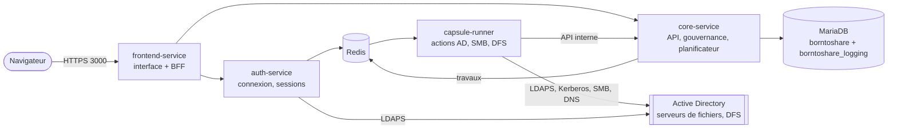
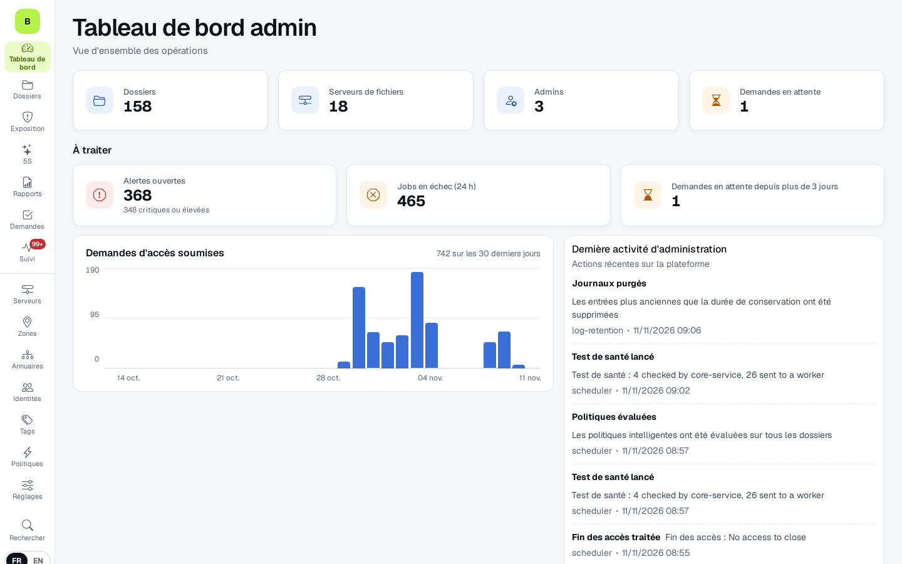
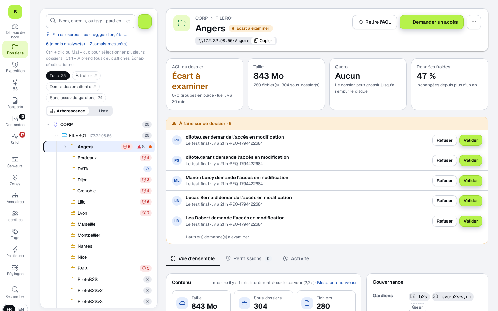
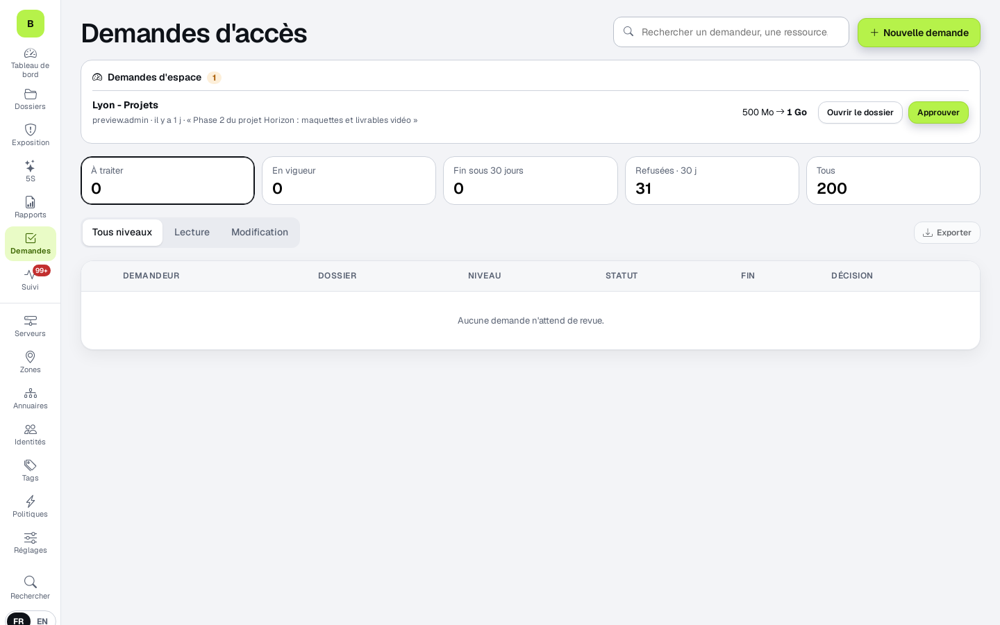
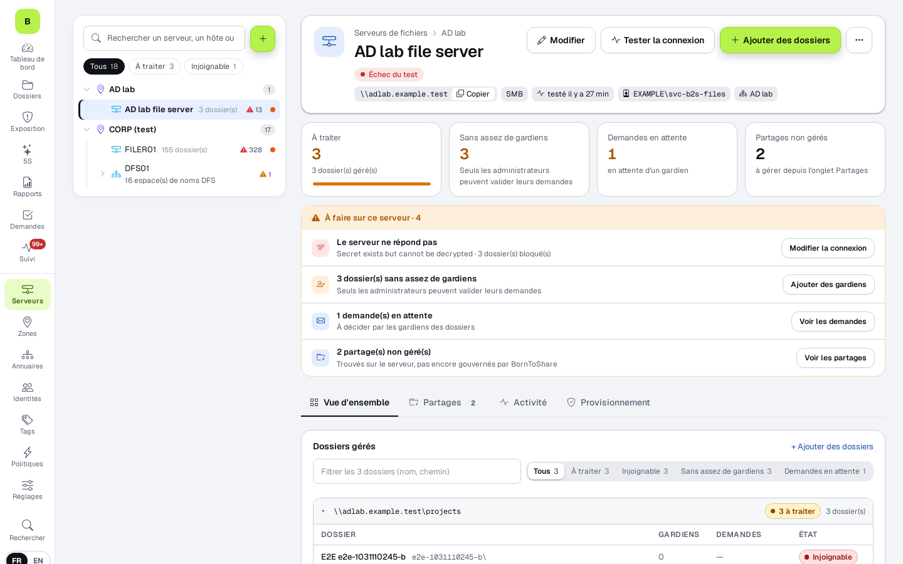
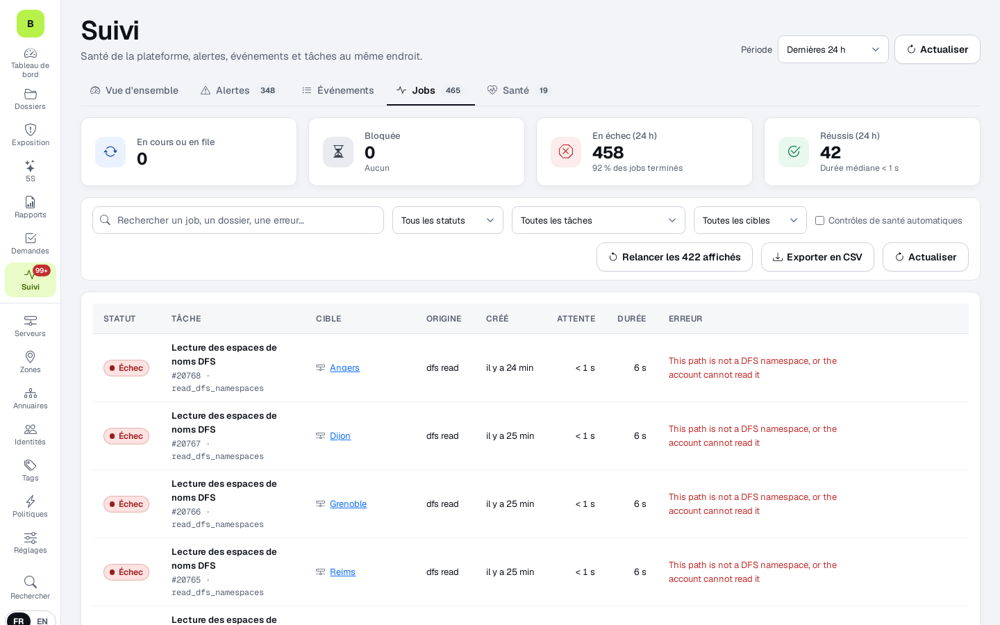
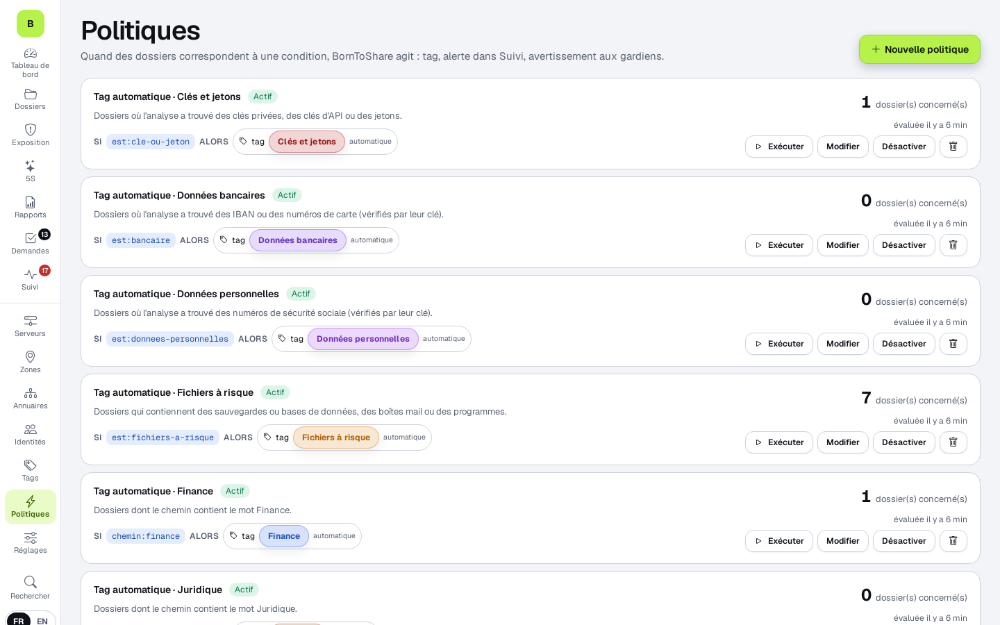
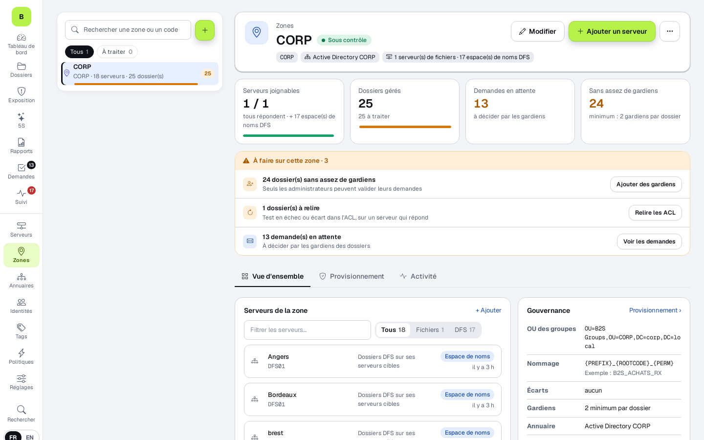

# BornToShare

BornToShare gouverne l'accès aux dossiers partagés Windows (SMB et DFS) à partir de l'Active Directory.
Un utilisateur demande un accès à un dossier, un gardien du dossier le valide, et BornToShare l'applique :
groupe AD créé dans l'OU de la zone, membre ajouté, ACL NTFS posée sur le dossier. À la fin de l'accès
ou à la révocation, le membre est retiré. Tout est tracé dans un journal d'audit chaîné.

## Vue d'ensemble



| Conteneur | Rôle | Documentation |
|---|---|---|
| frontend-service | Interface SvelteKit et BFF (seule entrée publique) | [frontend-service/README.md](frontend-service/README.md) |
| auth-service | Connexion (comptes locaux, AD, SSO Keycloak), sessions | [auth-service/README.md](auth-service/README.md) |
| core-service | Données, gouvernance, audit, coffre des secrets, planificateur | [core-service/README.md](core-service/README.md) |
| capsule-runner | Worker : toutes les actions sur l'AD et les serveurs | [capsule-runner/README.md](capsule-runner/README.md) |
| redis | File des travaux et sessions | [docs/architecture.md](docs/architecture.md) |
| wizard-ui | Installation (bases, administrateur, licence, module 5S), une seule fois | [wizard-ui/README.md](wizard-ui/README.md) |

## Démarrer

1. Préparer une base MariaDB et un hôte Linux avec Podman : [docs/installation.md](docs/installation.md).
2. `cp .env.example .env && chmod 600 .env`, puis renseigner chaque valeur.
3. `make wizard` : le wizard crée les bases, le compte SQL de l'application et le premier administrateur.
4. `make wizard-down`, puis `make up` : l'application répond sur `FRONTEND_PUBLIC_ORIGIN`.
5. À la première connexion, l'assistant de premier démarrage (`/setup`) déclare l'annuaire, le premier serveur
   de fichiers et les premiers dossiers.

Mises à jour : `make deploy` (paquets SQL, point de retour, reconstruction). Voir [docs/installation.md](docs/installation.md).

## Documentation

| Sujet | Fichier |
|---|---|
| Architecture, réseaux, flux à ouvrir | [docs/architecture.md](docs/architecture.md) |
| Installation, `.env`, wizard, mises à jour, sauvegarde | [docs/installation.md](docs/installation.md) |
| Sécurité : jetons, secrets, comptes de service, droits AD | [docs/securite.md](docs/securite.md) |
| Provisionnement AD (groupes, OU, adoption) | [docs/provisionnement-ad.md](docs/provisionnement-ad.md) |
| Infrastructure : santé, planifications, workers | [docs/infrastructure.md](docs/infrastructure.md) |
| SSO Keycloak | [docs/keycloak.md](docs/keycloak.md) |
| Observabilité | [docs/observability.md](docs/observability.md) |
| Pilote sur un AD Windows | [docs/pilote-windows.md](docs/pilote-windows.md) |
| AD de test et tests de bout en bout | [docs/ad-lab.md](docs/ad-lab.md) |
| Règles de travail sur le code | [Agents.md](Agents.md) |

## Commandes

```text
make up | down | restart | ps | logs | logs-<service>
make deploy            mise à jour : paquets SQL, point de retour, reconstruction
make backup            sauvegarde des deux bases dans backups/ (pas la clé des secrets)
make wizard            wizard d'initialisation ; make wizard-down pour l'arrêter
make ad-lab-up         AD de test pour les tests de bout en bout (jamais en production)
make lint              contrôle du code Python des quatre services (Ruff, règles dans ruff.toml)
```

## Aperçu

| | |
|---|---|
|  Tableau de bord |  Dossiers : arborescence et détail |
|  Demandes d'accès |  Serveurs de fichiers |
|  Observabilité › Jobs |  Politiques intelligentes |
|  Zones |  Connexion |

Captures faites sur l'instance de démonstration (données de laboratoire).
