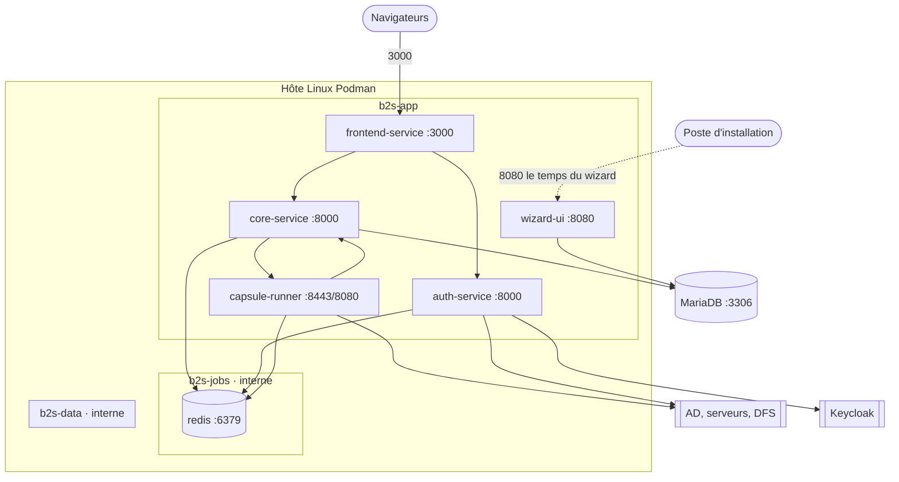
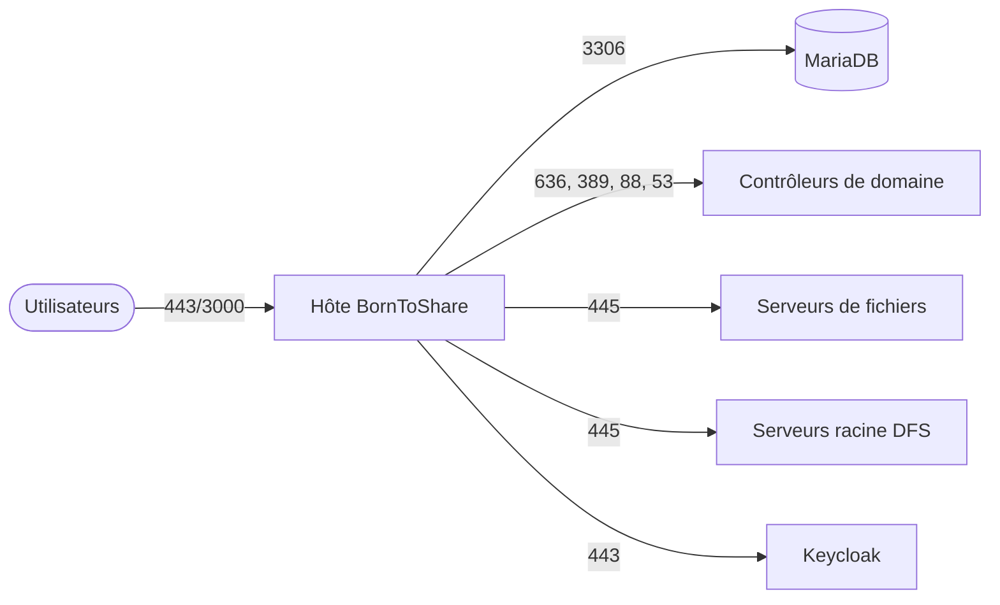
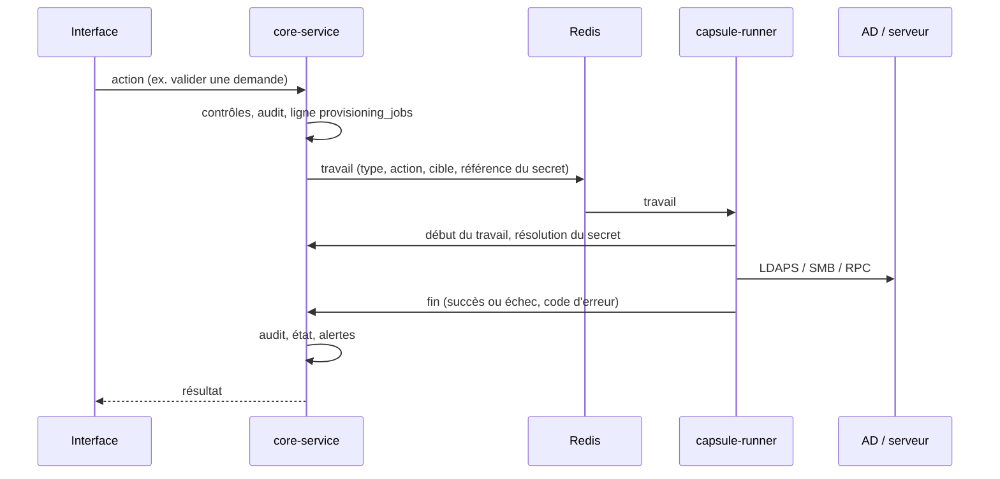

# Architecture

## Composants

| Conteneur | Image | Port | Réseaux | Rôle |
|---|---|---|---|---|
| frontend-service | `b2s-frontend-service` (Node, SvelteKit adapter-node) | 3000, **publié** | app | Interface et BFF : toutes les requêtes du navigateur passent par lui |
| auth-service | `b2s-auth-service` (Python, FastAPI) | 8000, interne | app, jobs | Connexion : comptes locaux, AD (LDAP/LDAPS), SSO Keycloak (OIDC) ; sessions dans Redis |
| core-service | `b2s-core-service` (Python, FastAPI) | 8000, interne | app, data, jobs | API métier, gouvernance, audit, coffre des secrets, planificateur ; publie les travaux |
| capsule-runner | `b2s-capsule-runner` (Python, Dramatiq + agent) | 8443 ou 8080, interne | app, jobs | Worker : exécute toutes les actions sur l'AD, les serveurs de fichiers et le DFS |
| redis | `redis:8.10` | 6379, interne | jobs | File des travaux (base 2) et sessions (base 1), persistée (AOF) |
| wizard-ui | `b2s-wizard-ui` (Python, FastAPI) | 8080, **publié** le temps de l'installation | app, data | Crée les bases, applique les paquets SQL, crée le premier administrateur |
| MariaDB | externe | 3306 | — | Bases `borntoshare` (données) et `borntoshare_logging` (audit chaîné) |

Le worker est le **seul** conteneur qui modifie l'AD et les serveurs. core-service ne parle jamais à l'AD :
il publie un travail, le worker l'exécute avec le compte de service du serveur ou de l'annuaire, puis rend
le résultat à core-service par son API interne.

## Réseaux Podman

- `b2s-app` : réseau des services ; c'est par lui que les conteneurs sortent vers l'extérieur (MariaDB, AD, Keycloak).
- `b2s-jobs` (interne, sans sortie) : Redis n'est joignable que par auth-service, core-service et capsule-runner.
- `b2s-data` (interne) : réservé aux échanges avec une base hébergée dans un conteneur sur le même hôte.

## Flux entre conteneurs

| De | Vers | Port | Contenu | Authentification |
|---|---|---|---|---|
| Navigateur | frontend-service | 3000 (HTTPS via le proxy) | Pages, `/api/*` du BFF | Cookie de session signé |
| frontend-service | auth-service | 8000 | Connexion, session, SSO | Jeton interne |
| frontend-service | core-service | 8000 `/api` | Toutes les routes métier | Jeton interne + identité de l'utilisateur |
| core-service | Redis | 6379 base 2 | Publication des travaux (Dramatiq) | Mot de passe Redis |
| auth-service | Redis | 6379 base 1 | Sessions | Mot de passe Redis |
| capsule-runner | Redis | 6379 base 2 | Lecture des travaux | Mot de passe Redis |
| capsule-runner | core-service | 8000 `/api/internal/*` | Début et fin de travail, résolution d'un secret, DNS des domaines | Jeton interne |
| core-service | capsule-runner | 8443 (HTTPS) ou 8080 | Agent : santé du worker | Identifiants d'agent |
| core-service, wizard-ui | MariaDB | 3306 | Données et audit | Compte SQL de l'application |

## Flux à ouvrir vers l'extérieur

L'hôte BornToShare doit pouvoir joindre :

| Destination | Port | Protocole | Utilisé par | Pour |
|---|---|---|---|---|
| MariaDB | 3306/TCP | MySQL | core-service, wizard-ui | Données et journal d'audit |
| Contrôleurs de domaine | 636/TCP | LDAPS | worker, auth-service | Annuaire : lecture, groupes, membres ; connexion des utilisateurs |
| Contrôleurs de domaine | 389/TCP | LDAP | worker (découverte) | Lecture du rootDSE ; le bind simple en clair est refusé par un AD durci |
| Contrôleurs de domaine | 88/TCP+UDP | Kerberos | worker | Test Kerberos |
| Serveurs DNS des domaines | 53/TCP+UDP | DNS | worker | Résolution des serveurs (Réglages avancés › Réseau et DNS) |
| Serveurs de fichiers | 445/TCP | SMB 3 | worker | Partages, dossiers, ACL NTFS, création et suppression de partages |
| Serveurs racine DFS et contrôleurs | 445/TCP | SMB + RPC netdfs | worker | Lecture des espaces de noms, référencements, dossiers DFS |
| Keycloak (si SSO) | 443/TCP | HTTPS OIDC | auth-service, navigateurs | Connexion SSO |

Ouvert vers l'hôte : 3000/TCP (ou 443 via un proxy inverse) pour les utilisateurs ; 8080/TCP pour le wizard,
seulement pendant l'installation. Rien d'autre n'est publié.

## Données

- `borntoshare` : zones, annuaires, serveurs, dossiers, profils d'accès (groupes AD), demandes, travaux
  (`provisioning_jobs`), planifications (`infra_schedules`), secrets chiffrés (`secret_items`), alertes.
- `borntoshare_logging` : `audit_event`, chaîné par hachage (`hash_prev`, `hash_current`) ; une ligne ne se
  réécrit jamais.
- `config/runtime` (monté dans core-service) : connexion à la base choisie dans Réglages avancés ›
  Infrastructure ; quand elle existe, elle remplace les `DB_*` du `.env`.
- Redis : file des travaux et sessions ; un redémarrage ne perd ni l'une ni les autres (AOF).

Les paquets SQL sont dans `wizard-ui/backend/app/sql` (schema, views, indexes, logging, seeds). Le wizard les
applique tous à l'installation ; `make deploy` rejoue la liste `PACKS` de `scripts/deploy.sh`, et chaque
paquet doit donc pouvoir être appliqué plusieurs fois.

## Travaux

Une action sur l'AD ou un serveur suit toujours le même chemin :

Le contrat des travaux (type, file, action par défaut) existe en deux copies identiques :
`core-service/app/jobs/b2s_job_contracts` et `capsule-runner/app/shared/b2s_job_contracts`.
Les règles de nommage Windows sont aussi partagées (`windows_names.py`). Un test vérifie que les copies ne
divergent pas, et un autre que chaque action est déclarée partout où elle doit l'être.

## Planificateur

core-service exécute toutes les 30 s les tâches dues de `infra_schedules`. Un verrou MariaDB garantit qu'une
seule instance les lance.

| Tâche | Intervalle par défaut | Rôle |
|---|---|---|
| `health_check` | 5 min | Bases, file, workers, puis chaque annuaire et serveur depuis un worker ; secrets perdus |
| `data_sync` | 6 h | Instantanés d'annuaire, découverte des partages, dérive des ACL et des groupes |
| `access_expiry` | 15 min | Retire des groupes AD les accès arrivés à échéance |
| `dfs_read` | 6 h | Relit chaque espace de noms DFS |

Les intervalles se règlent dans Réglages avancés › Infrastructure › Planification.
